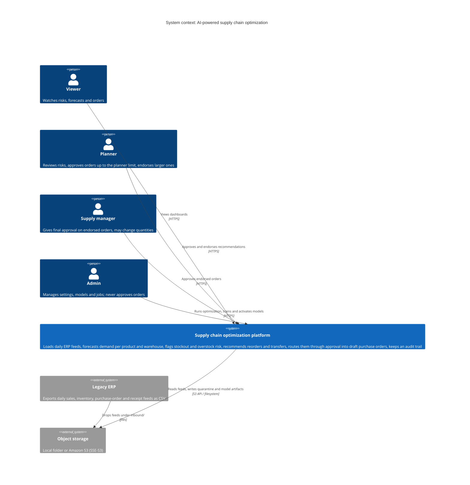

# Architecture (C4)

Two C4 levels for the AI-powered supply chain optimization platform. Diagrams are
Mermaid, so GitHub renders them in place. The table below the container diagram lists
every service in `compose.yaml` and how it talks to the others.

## Level 1: System context

## Level 2: Containers

```mermaid
C4Container
  title Containers: every service in compose.yaml

  Person(user, "Supply chain user", "Viewer, planner, supply manager or admin, in a browser")
  System_Ext(erp, "Legacy ERP", "Daily CSV feeds")
  ContainerDb(store, "Object storage", "data/ folder or S3", "inbound/, raw/, quarantine/, eval/, models/demand/<version>/")

  System_Boundary(platform, "Supply chain optimization platform") {
    Container(caddy, "Caddy", "Caddy 2, ports 443 and 80", "TLS, security headers; serves the dashboard and routes /api, /auth and /grafana")
    Container(dashboard, "Dashboard", "React 18, TypeScript, Vite", "Single-page app running in the browser")
    Container(keycloak, "Keycloak", "Keycloak 26, /auth", "Realm supplychain, PKCE sign-in, roles in realm_access")
    Container(platformapi, "Platform API", "Java 21, Spring Boot, :8080", "Risk engine, transfer planner, approval workflow, audit log; circuit breaker around the forecast service")
    Container(forecastapi, "Forecast API", "Python, FastAPI, :8000 (host 8001)", "Model registry, forecast runs, series history; service token")
    Container(forecastworker, "Forecast worker", "Python, XGBoost, metrics :9100", "Trains, backtests and runs 28-day forecasts")
    Container(etlworker, "ETL worker x2", "Python, metrics :9100", "Validates feeds, quarantines bad rows, loads facts")
    ContainerQueue(rabbitmq, "RabbitMQ", "RabbitMQ 3.13, :5672, :15672, :15692", "Exchanges erp and ml; etl.feed and forecast.jobs with retry and dead-letter queues")
    ContainerDb(postgres, "PostgreSQL", "PostgreSQL 16, :5432", "Schemas core, ops, eval, ml, app; Keycloak database; one role per service")
    Container(flyway, "Flyway", "Flyway 10, one-shot", "Applies db/migrations scripts; the only source of DDL")
    Container(prometheus, "Prometheus", "Prometheus 3, :9090", "Scrapes every service every 15 s")
    Container(grafana, "Grafana", "Grafana 11, :3000 under /grafana", "Operations dashboard from provisioned files")
  }

  Rel(user, caddy, "Uses", "HTTPS")
  Rel(caddy, dashboard, "Serves static files")
  Rel(dashboard, keycloak, "Signs in with PKCE", "HTTPS /auth")
  Rel(dashboard, platformapi, "Calls with bearer token", "HTTPS /api/v1, JSON")
  Rel(caddy, grafana, "Proxies /grafana", "HTTP")
  Rel(platformapi, keycloak, "Validates JWTs against JWKS", "HTTP")
  Rel(platformapi, forecastapi, "Series, models, forecast runs", "HTTP, service token")
  Rel(platformapi, postgres, "Reads core, ops, ml, eval; writes app", "JDBC as platform_api")
  Rel(forecastapi, postgres, "Reads core, writes ml", "psycopg pool as forecast_service")
  Rel(forecastapi, rabbitmq, "Publishes forecast and training jobs", "AMQP, exchange ml")
  Rel(rabbitmq, forecastworker, "Delivers forecast.jobs", "AMQP")
  Rel(forecastworker, postgres, "Reads core, writes ml", "SQL, COPY")
  Rel(forecastworker, store, "Writes and reads model.ubj and metadata.json")
  Rel(forecastapi, store, "Reads model metadata")
  Rel(erp, store, "Drops feeds")
  Rel(rabbitmq, etlworker, "Delivers etl.feed", "AMQP")
  Rel(etlworker, store, "Reads feeds, writes raw and quarantine")
  Rel(etlworker, postgres, "Loads core, records ops", "SQL, COPY")
  Rel(keycloak, postgres, "Own database", "JDBC")
  Rel(flyway, postgres, "Migrates schemas", "JDBC")
  Rel(prometheus, platformapi, "Scrapes /actuator/prometheus")
  Rel(prometheus, forecastapi, "Scrapes /metrics")
  Rel(prometheus, forecastworker, "Scrapes :9100")
  Rel(prometheus, etlworker, "Scrapes :9100 on each replica")
  Rel(prometheus, rabbitmq, "Scrapes :15692")
  Rel(grafana, prometheus, "PromQL")
  Rel(grafana, postgres, "Read-only SQL", "grafana_reader")

  UpdateLayoutConfig($c4ShapeInRow="4", $c4BoundaryInRow="1")
```

## Services and connections

| Service | Owner | Image or build | Host port | Talks to |
|---|---|---|---|---|
| caddy | Rik | `dashboard/Dockerfile` (Caddy 2 + built dashboard) | 443, 80 | dashboard files, platform-api:8080 (`/api/*`), keycloak:8080 (`/auth/*`), grafana:3000 (`/grafana/*`) |
| keycloak | C | quay.io/keycloak/keycloak:26 | 8180 | postgres (own database) |
| platform-api | C | `services/platform-api/Dockerfile` | 8080 | postgres as `platform_api`, keycloak JWKS, forecast-api with the service token |
| forecast-api | B | `infra/forecast/Dockerfile` | 8001 -> 8000 | postgres as `forecast_service`, rabbitmq (publish to `ml`), object storage (read) |
| forecast-worker | B | same image, `scforecast worker` | none (metrics :9100 inside) | rabbitmq (`forecast.jobs`), postgres as `forecast_service`, object storage (read and write) |
| etl-worker (2 replicas) | A | `infra/etl/Dockerfile` | none (metrics :9100 inside) | rabbitmq (`etl.feed`), postgres, object storage |
| rabbitmq | A | rabbitmq:3.13-management-alpine with `rabbitmq_prometheus` | 5672, 15672 | consumed by etl-worker and forecast-worker |
| postgres | A | postgres:16-alpine | 5432 | used by every service with its own role |
| flyway | A | flyway/flyway:10-alpine (one-shot) | none | postgres |
| prometheus | B | prom/prometheus:v3.1.0 | 9090 | scrapes platform-api, forecast-api, forecast-worker, etl-worker, rabbitmq |
| grafana | B | grafana/grafana:11.4.0 | 3000 | prometheus, postgres as `grafana_reader` (read-only) |

All host ports bind to 127.0.0.1 except Caddy's 443 and 80. Inside Compose, services
reach each other by service name on the default network.

## Main flows

1. **Feed load.** The ERP drops a day's feeds; `scetl enqueue` publishes one message per
   file to exchange `erp`; the two ETL workers compete for `etl.feed`, validate every row,
   quarantine bad rows and load the rest into `core`. Failures retry after 1, 2 and 4
   seconds, then go to `etl.feed.dlq`.
2. **Training.** `POST /v1/training-runs` on the forecast API (or `scforecast train`)
   queues a training job. The job goes through `forecast.jobs` to
   the forecast worker, which trains, backtests against seasonal naive, applies the
   quality gate and registers the model in `ml.model_version`.
3. **Forecast.** `POST /v1/forecast-runs` records a `QUEUED` run and publishes a job; the
   worker writes 112,000 rows (4,000 series x 28 days) and marks the run `SUCCEEDED`. A
   job that fails four times lands in `forecast.jobs.dlq` and the run is marked `FAILED`.
4. **Decisions.** The platform API reads `ml.v_current_forecast`, runs the risk engine and
   transfer planner, and routes recommendations through planner and manager approval into
   draft orders, writing every step to the audit log.
5. **Observability.** Prometheus scrapes all services; Grafana shows API latency and errors,
   the circuit breaker, queue and dead-letter depth, ETL rows loaded vs quarantined and
   model WAPE vs baseline.
